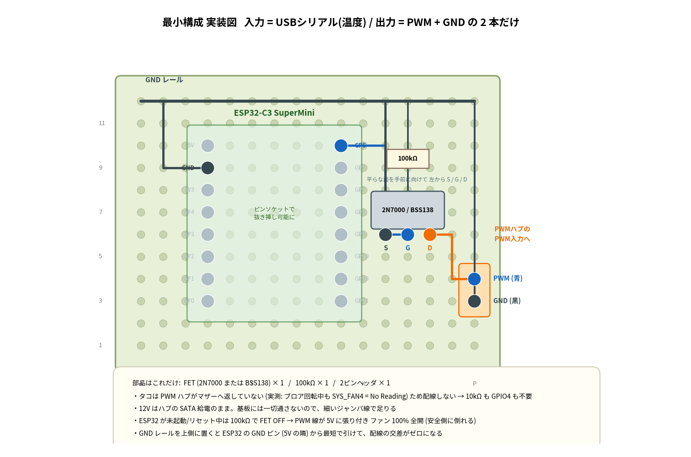

# ESP32-C3 ブロアファンコントローラ 部品表・配線表

対象ファン: **BitWindow BFB1012EH** (12V / 2.94A ≒ 35W / 7000rpm / 4PIN PWM)
配線図: [wiring.png](wiring.png)

## 1. 部品表 (必須)

| # | 部品 | 型番・仕様 | 数量 | 価格目安 | 入手先 |
|---|---|---|---|---|---|
| 1 | マイコンボード | **ESP32-C3 SuperMini** (USB-C, 技適が必要ならXIAO ESP32C3) | 1 (予備込み2) | 300〜500円 | AliExpress / Amazon |
| 2 | Nch MOSFET | **BSS138** (SOT-23) / **2N7002** / 手配線なら **2N7000** (TO-92) | 1 | 20円 | 秋月・共立・AliExpress |
| 3 | 抵抗 | **100kΩ** 1/4W (ゲートプルダウン) | 1 | 5円 | [共立 6AZ312](https://eleshop.jp/shop/g/g6AZ312/) ¥5/20本 |
| 4 | 2ピンヘッダ | 出力用 | 1 | 10円 | 秋月・共立 |
| 5 | 4PIN分岐ケーブル | **手持ちのPWMハブ用分岐ケーブルを流用** | - | 0円 | - |

**合計 約400〜600円** (ESP32 以外は 40 円程度)

### 不要になったもの

| 部品 | 理由 |
|---|---|
| ~~10kΩ (タコプルアップ)~~ | **PWMハブがタコをマザーへ返していない**ことを実測で確認済み
(ブロアが 100% で回っている最中も `SYS_FAN4 = No Reading`)。
タコを取るにはハブを介さずファンの黄線へ直結する必要があり、
今回は見送るため不要 |
| ~~NTCサーミスタ~~ | ホスト停止時は SATA 12V も切れてファンごと止まるため不要 |
| ~~4PIN延長ケーブル~~ | 手持ちの分岐ケーブルを流用 |

## 2. あると良い物 (任意)

| 部品 | 用途 | 価格 |
|---|---|---|
| ユニバーサル基板 (小) | FETと抵抗の固定 | 50円 |
| ピンヘッダ / ピンソケット | ESP32を挿抜可能にする | 50円 |
| 熱収縮チューブ | 絶縁処理 | 100円 |
| 1kΩ 抵抗 | ゲート直列 (リンギング抑制。無くても可) | 5円 |

## 3. MOSFET 選定の根拠

PWM線は**信号線**であり、ファン内部の 5V プルアップ (典型 3.3k〜10kΩ) を
引き下げるだけ。IPMI/Intel 4-wire 仕様でのシンク電流は **最大 5mA**。

- 2N7000 (Vgs(th) 最大 3V) を 3.3V で駆動するとオン抵抗が悪化するが、
  `5mA × 50Ω = 0.25V` で VIL(max) 0.8V に対し十分な余裕がある → **実用可**
- ただし同価格でロジックレベル品が買えるので **BSS138 / 2N7002 を推奨**
- `74LVC1G07` (オープンドレインバッファ、5Vトレラント) でも代替可

※ **12V電源そのものをスイッチする場合は話が別**で、2.94A を流すには
`AO3400A` 等のロジックレベル Nch をローサイドに入れる必要がある。
本設計では 12V は SATA から常時給電し、PWM duty のみで制御するため不要。

## 4. 配線表

### ESP32-C3 SuperMini 側

| ESP32 ピン | 接続先 | 備考 |
|---|---|---|
| **GPIO5** | FET ゲート (100kΩ で GND へプルダウン) | 25kHz PWM 出力 (LEDC) |
| GND | 出力コネクタ GND / SATA の GND と共通 | **必須** |
| USB-C | ホストPCへ | 給電 + シリアル (native USB-CDC)。**入力は温度だけ** |

出力は **PWM と GND の 2 本のみ**。接続先は PWM ハブの「マザーへ挿す側の
4PIN オスプラグ」で、その **pin4 (PWM, 青)** と **pin1 (GND, 黒)** を使う。
12V (pin2) と Tach (pin3) は触らない。

#### ESP32-C3 で使ってはいけないピン

| ピン | 理由 |
|---|---|
| **GPIO2 / GPIO8 / GPIO9** | **ストラッピングピン**。起動時のレベルでブートモードが決まる。
特に GPIO2 と GPIO8 は High である必要があり、100kΩ プルダウンを付けると**ブートに失敗する**。GPIO9 は Low で書き込みモードに入る (ボード上の BOOT ボタン) |
| GPIO18 / GPIO19 | native USB (D-/D+)。USB-CDC シリアルで使用中 |
| GPIO11〜17 | SuperMini では未実装 / 内蔵フラッシュ用 |

→ 空いている **GPIO0, 1, 3, 4, 5, 6, 7, 10** から選ぶ。本設計では
PWM=GPIO5、タコ=GPIO4 とした (GPIO8 はオンボードLED、状態表示に流用可)。

### ファン 4PIN コネクタ側

| Pin | 名称 | 線色 | 接続先 |
|---|---|---|---|
| 1 | GND | 黒 | SATA の GND (ESP32 の GND と共通) |
| 2 | +12V | 赤 | SATA の +12V (黄) |
| 3 | Tach | 黄/緑 | ESP32 GPIO3 (10kΩ で 3.3V プルアップ) |
| 4 | PWM | 青 | FET ドレイン |

### FET (BSS138 / 2N7000)

| 端子 | 接続先 |
|---|---|
| G (ゲート) | ESP32 GPIO2 + 100kΩ → GND |
| D (ドレイン) | ファン PWM (青, pin4) |
| S (ソース) | GND |

## 4.5 基板の実装図

ユニバーサル基板 **20×14穴 (約51×36mm)**、2.54mmピッチ。秋月の
「Cタイプ (72×47mm)」を切って使うか、小さめの基板をそのまま使う。

### 実装の手順

1. **ピンソケット 2×8 を 6 ピッチ間隔で取り付ける**
   ESP32-C3 SuperMini のピン列間隔は約 15.24mm (= 6 穴)。
   **必ず現物をあてて確認してから**はんだ付けする。
2. **GND レール (最下行) と 3V3 レール (最上行) をスズメッキ線で引く**
3. ESP32 の `GND` → GND レール、`3V3` → 3V3 レールへジャンパ
4. **2N7000 を挿す** (平らな面を手前にして左から S / G / D)
   - S → GND レール
   - G → ESP32 `GPIO5`、さらに **100kΩ** で GND レールへ
   - D → 出力コネクタの PWM ピン
5. **10kΩ** を 3V3 レールからタコノードへ。タコノードは
   ESP32 `GPIO4` と出力コネクタの Tach ピンに接続
6. 出力は **3ピンのピンヘッダ** (Tach / PWM / GND) にして、
   切断した 4PIN ファン延長ケーブルを挿す

### 配線リスト (穴座標 / 16×12穴)

| 線 | 経路 | 色 |
|---|---|---|
| GND レール (最上段) | A12 → P12 | 黒 |
| ESP32 GND → レール | D9 → B9 → B12 | 黒 |
| GPIO5 → FET ゲート | J10 → L10 → L6 → M6 | 青 |
| FET ソース → GND レール | L6 → L12 | 黒 |
| ゲートプルダウン 100kΩ | M6 → M9 → M12 | - |
| FET ドレイン → 出力 PWM | N6 → O6 → O4 → P4 | 橙 |
| 出力 GND → GND レール | P3 → P12 | 黒 |

**GND レールを上側に置いたので配線の交差はゼロ** (ESP32 の GND ピンは
5V の隣＝上側にあるため、上レールへ最短で引ける)。

## 5. 組み立て前に確認すること

1. **ファンのPWMプルアップ電圧をテスターで測る**
   PWM線を開放にして電圧を測定。5V なら本設計どおり。3.3V のファンも
   存在し、その場合は FET 無しで直結もあり得る。
2. **GNDが共通になっているか**
   ESP32 をホストのUSBから給電すれば、ホストPSU経由で SATA の GND と
   自動的に共通になる。別のACアダプタから給電してはいけない。
3. **FET無しで直結しない**
   5V プルアップのファンに ESP32 (絶対最大定格 3.6V) を直結すると破損する。

## 6. ファームウェアの要点

- PWM は **LEDC で 25kHz / 分解能 10bit**
- FET で論理が反転するため、出力は `duty_out = 1023 - duty_target`
- シリアルプロトコル: ホストから `T <温度>\n` を5秒周期で受信、
  ESP32 側にカーブを持たせる (ホストが落ちても最後の温度から継続可能)
- **30秒間受信が無ければ 100% 全開** (ホストのフリーズ対策)
- タコ計測: 立下り割り込みでパルス計数、`RPM = パルス毎秒 × 30`
- duty を指示しているのに RPM が 0 → **失速検知** → 100% + エラー通知

## 7. 現行 (BMC Web API) 版との関係

ESP32 版に移行してもマザーボードの SYSFAN ヘッダーは使わないため、
BMC・Web API・ファームウェアの挙動から完全に独立する。
現行の [pwmd.py](../pwmd.py) は `[fan] backend = bmc | serial` で
切り替えられるようにする予定で、温度取得・カーブ・ログ・ウォッチドッグの
資産はそのまま流用できる。ESP32 が故障したら PWM 線を SYS_FAN4 に
差し替えるだけで BMC 版へ戻せる。
